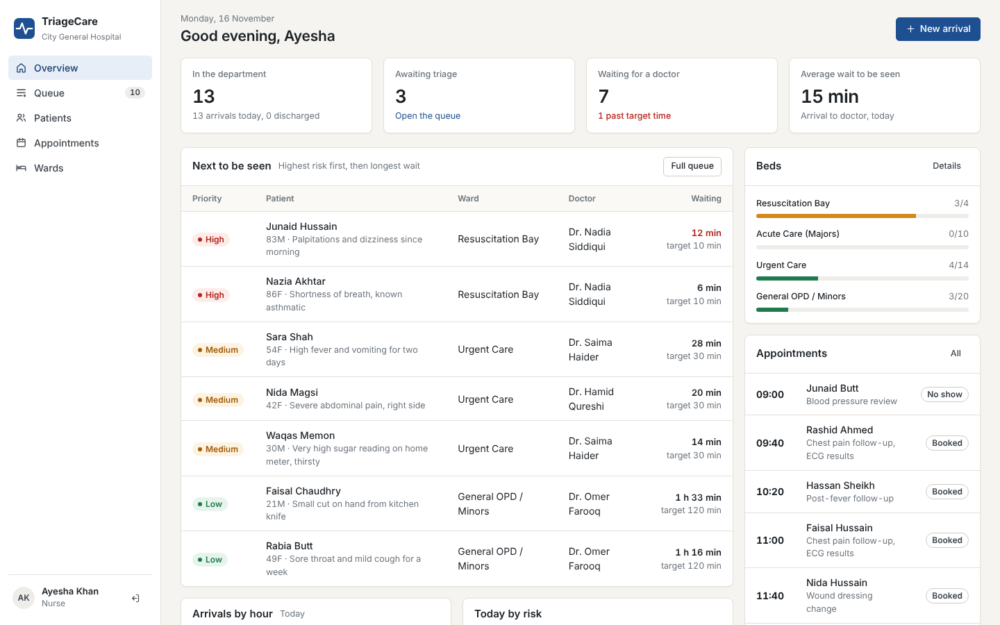
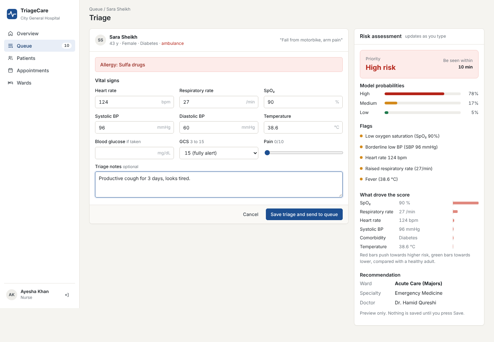
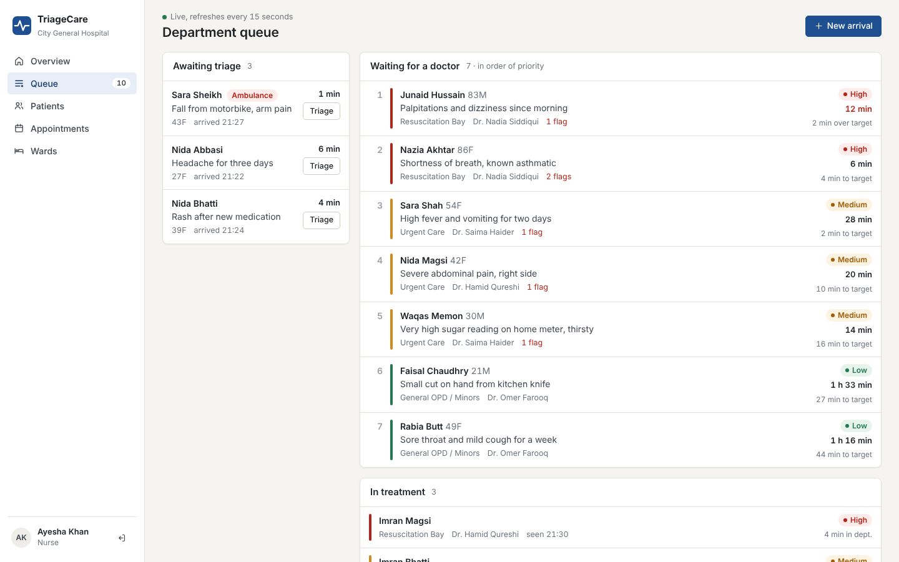
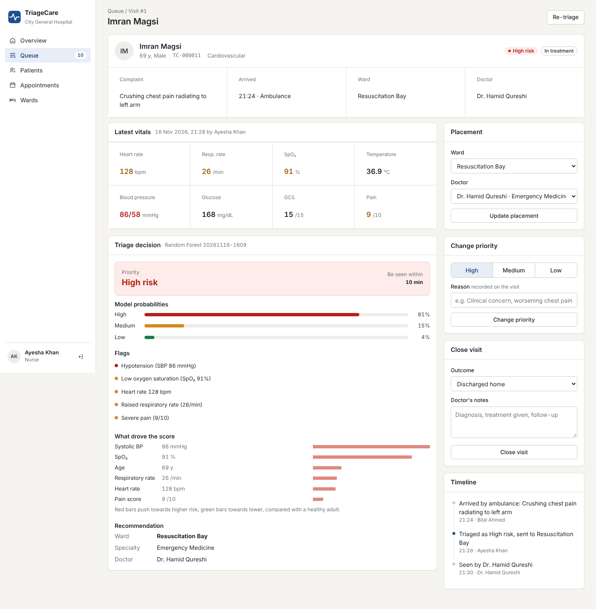
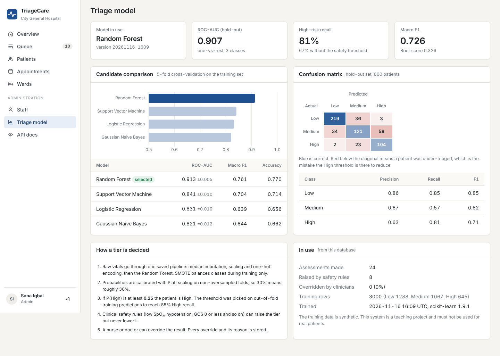

# TriageCare

An emergency department triage system. Reception registers patients and books appointments, nurses record vitals, and a machine learning model, checked by clinical safety rules, decides how urgently each patient needs a doctor. The queue, ward beds and doctor assignments update from there.

Built with FastAPI, SQLAlchemy, scikit-learn and server-rendered HTML with HTMX.



> **Teaching project.** The model is trained on synthetic data. Don't use it for real patients.

---

## What it does

| Role | Can do |
|---|---|
| **Receptionist** | Register and search patients, book appointments, check patients in, register walk-ins |
| **Nurse** | Everything reception can, plus triage: enter vitals, see the risk live, send to the queue |
| **Doctor** | See their own patients, pick up the next patient, change priority with a reason, reassign ward or doctor, close a visit |
| **Admin** | All of the above, plus staff accounts and the model performance page |

**Patient flow**

```
Register patient ─► Arrival (walk-in, ambulance or checked-in appointment)
                 ─► Triage: vitals ─► ML model + safety rules ─► Low / Medium / High
                 ─► Ward + specialty + on-duty doctor recommended
                 ─► Queue (highest risk first, then longest wait)
                 ─► Doctor starts treatment ─► Discharged / admitted / referred
```

Every step is written to a timeline on the visit, so you can see who did what and when.

**Highlights**

- **Live risk preview.** The triage form re-scores the patient as the nurse types, before anything is saved.
- **Explainable.** Each assessment shows which vitals pushed the risk up or down.
- **Safety first.** Clinical red flags (SpO₂ below 88%, systolic BP below 90, GCS 8 or less and others) can raise the model's tier but never lower it.
- **Target times.** High = 10 min, Medium = 30 min, Low = 2 h. Patients past their target are highlighted in the queue.
- **Live queue.** Refreshes every 15 seconds without reloading the page.
- **Ward board.** Bed occupancy per ward. When the preferred ward is full, routing falls back to the next suitable one.
- **REST API** with interactive docs at `/docs`.

| Triage | Queue |
|---|---|
|  |  |
| **Visit** | **Model** |
|  |  |

---

## Getting started

You need **Python 3.10 or newer** and Git.

```bash
git clone https://github.com/samadbaloch2005/End-to-End-Medical-Triage-Assistant.git
cd End-to-End-Medical-Triage-Assistant

python3 -m venv .venv
source .venv/bin/activate          # Windows: .venv\Scripts\activate
pip install -r requirements-dev.txt

python -m triagecare.cli setup     # creates the database, trains the model, adds demo data
uvicorn triagecare.main:app --reload
```

Open <http://localhost:8000> and sign in with one of the demo accounts. They're also one-click buttons on the login page.

| Username | Role | Password |
|---|---|---|
| `admin` | Admin | `triage123` |
| `reception` | Receptionist | `triage123` |
| `nurse` | Nurse | `triage123` |
| `dr.hamid` | Doctor, Emergency Medicine | `triage123` |
| `dr.usman` | Doctor, Cardiology | `triage123` |

`setup` is safe to run again. It won't re-seed a database that already has users. To start fresh, delete `triagecare.db` and run it again.

### Useful commands

```bash
python -m triagecare.cli train          # retrain the model (about 15 s)
python -m triagecare.cli migrate        # apply database migrations
python -m triagecare.cli create-admin sana "Sana Iqbal"
python -m pytest                        # run the tests
python -m src.train                     # training on its own, with full output
```

Settings come from environment variables or a `.env` file. See [`.env.example`](.env.example).

---

## The model

Training lives in `src/` and runs with `python -m src.train`.

1. **Data.** 3,000 synthetic ED patients (`data/generate_dataset.py`) with 11 features: age, sex, comorbidity, heart rate, respiratory rate, systolic BP, SpO₂, temperature, glucose, GCS and pain. Some BP and glucose values are missing on purpose.
2. **Split first.** 20% is held out before anything is fitted.
3. **One pipeline.** Imputation → scaling / one-hot encoding → SMOTE → classifier, built with `imblearn`. SMOTE runs inside the pipeline, so cross-validation never scores on oversampled rows. The saved pipeline takes raw values, which means the web app never repeats preprocessing.
4. **Model selection.** Logistic Regression, Gaussian Naive Bayes, SVM and Random Forest are compared with 5-fold stratified CV on ROC-AUC.
5. **Calibration.** The winner is wrapped in `CalibratedClassifierCV` (sigmoid), fitted on real, non-oversampled folds.
6. **Decision threshold.** Missing a High-risk patient is the expensive mistake. A lower threshold for High is chosen on out-of-fold training predictions to reach 85% High recall.
7. **Explanations.** For each feature, the patient's value is swapped with a healthy reference value, in both directions, and the change in expected risk is measured. This is model-agnostic, so it explains whichever model wins. See `src/explain.py`.

Results on the hold-out set (your numbers may differ slightly):

| | ROC-AUC | Macro F1 | High-risk recall |
|---|---|---|---|
| Random Forest, argmax | 0.907 | 0.751 | 67% |
| Random Forest, with High threshold | 0.907 | 0.726 | **81%** |

That's a small cost in F1 for catching about one in five more critical patients. The admin **Triage model** page shows the full comparison, the confusion matrix and how often clinicians override the model.

---

## Architecture

```
triagecare/
  main.py            app factory, middleware, error pages
  config.py          settings (env vars / .env)
  db.py, models.py   SQLAlchemy engine and tables
  schemas.py         Pydantic validation for forms and the API
  deps.py            current user, role checks, CSRF
  security.py        password hashing (PBKDF2), tokens
  services/
    triage.py        model loading, safety rules, ward/doctor routing
    queue.py         queue ordering, dashboard numbers
  routers/           one file per area: auth, patients, appointments, visits, queue, admin, api
  templates/         Jinja2 pages and HTMX partials (files starting with _)
  static/            CSS, a little JS, vendored HTMX and Chart.js
  seed.py, cli.py    demo data and project commands
src/                 ML: preprocessing, training, policy, explanations
migrations/          Alembic database migrations
tests/               pytest: rules, model, auth, end-to-end flows
```

**Database tables:** `users`, `patients`, `appointments`, `visits`, `triage_assessments`, `visit_events`, `wards`. A visit can have several assessments if the patient is re-triaged. The latest one sets the visit's priority.

**Why server-rendered HTML + HTMX instead of React?** One language, one deployable, no build step, and the pages still update in place (live search, live queue, live triage preview). The JSON API exists alongside it for anything else that wants the data.

**Security:** sessions are signed cookies (`SameSite=Lax`, `Secure` in production), every form POST is CSRF-checked, passwords are hashed with PBKDF2-SHA256, and each route declares the roles allowed to use it.

### API

Sign in through the website, then open `/docs`. Main endpoints:

| Method | Path | |
|---|---|---|
| `GET` | `/api/v1/health` | Status, and whether the model is loaded |
| `POST` | `/api/v1/predict` | Score vitals without saving (nurse/doctor) |
| `GET` | `/api/v1/queue` | Current queue in priority order |
| `GET` | `/api/v1/wards` | Bed occupancy |
| `GET` | `/api/v1/patients?q=` | Search patients |

---

## Deployment

### Docker (app + PostgreSQL)

```bash
docker compose up --build
```

Then open <http://localhost:8000>. The image trains the model at build time and seeds demo data on first start.

### Render (free hosting)

1. Push this repo to GitHub.
2. On [render.com](https://render.com): **New → Blueprint**, then pick the repo. `render.yaml` creates a PostgreSQL database and the web service.
3. Wait for the first build (a few minutes). The app is then live at `https://triagecare-xxxx.onrender.com`.

Free Render services sleep after 15 minutes of inactivity. The first request after that takes about a minute. Free databases expire after 30 days.

---

## Working on it as a team

- Branch off `main` for each change (`feature/appointment-reminders`), then open a pull request.
- GitHub Actions runs the tests on every PR (`.github/workflows/ci.yml`).
- After changing `models.py`, create a migration: `alembic revision --autogenerate -m "what changed"`, check the generated file, and commit it.
- Don't commit `.env`, `*.db` or the trained model. They're in `.gitignore` and `setup` rebuilds them.

`app/dashboard.py` and the `.pkl` files in `models/` are from the earlier Streamlit prototype. They're kept for reference but not used by the new app.

## Team

- Samad Ahmed ([samadbaloch2005](https://github.com/samadbaloch2005))
- Haider ([haideraleeee](https://github.com/haideraleeee))
- Muzammil Magsi
